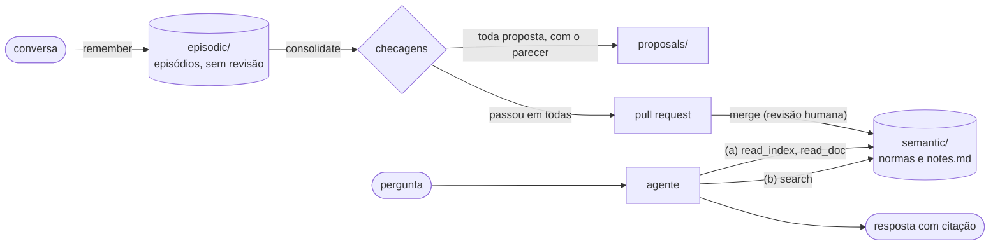

# tiered-memory-agent

> **PT:** Projeto pessoal, desenvolvido no meu tempo livre. Não tem relação com meu empregador e não usa código, dados ou
> informações dele. O desenho parte da literatura pública sobre memória de agentes e recuperação de conhecimento.
>
> **EN:** Personal project, built in my own time. It is not affiliated with my employer and uses none of its code, data or
> information. The design builds on public research on agent memory and knowledge retrieval.

Um assistente que responde dúvidas de restaurantes sobre boas práticas sanitárias, a partir das normas da ANVISA e do
Centro de Vigilância Sanitária de São Paulo, e aprende com as conversas. O que foi dito numa conversa só entra na base
depois de revisão humana. O projeto é um experimento com números: compara duas estratégias para o agente consultar a
base, mede quanto as checagens da consolidação barram e se a base revisada responde melhor que as conversas sem
revisão.

## Como funciona



As tools `remember`, `read_index`, `read_doc` e `search` ficam num servidor MCP, que qualquer cliente MCP pode usar.

- `semantic/`: memória semântica. As RDCs ANVISA 216/2004 e 275/2002 e as Portarias CVS 3/2026 e 9/2026 de São Paulo
  divididas por tema, com o texto literal das normas e um `index.md` em cada pasta. É gerada por
  `scripts/build_semantic.py` a partir de `sources/` (ver [sources/SOURCES.md](sources/SOURCES.md)).
- `episodic/`: memória episódica. Notas em markdown com frontmatter (título, fonte, data, tags) e links entre notas;
  entram sem revisão.
- `src/tiered_memory_agent/server.py`: servidor MCP com as tools `remember`, `read_index`, `read_doc` e `search`.
- Duas estratégias de recuperação: (a) navegação por índice, em que o agente desce pelos `index.md` com `read_index`
  e `read_doc`; (b) busca por embeddings (`search`, em `search.py`), com o modelo local
  [multilingual-e5-small](https://huggingface.co/intfloat/multilingual-e5-small) e um trecho por item de norma.
- `eval/questions.jsonl`: perguntas com resposta e item-fonte esperados, inclusive perguntas sem resposta na base.
  `eval/retrieval.py` mede se a busca (b) traz o item esperado entre os k primeiros, sem LLM.
- Harness de avaliação: `src/tiered_memory_agent/agent.py` é o agente (Gemini 3.5 Flash-Lite) que responde cada
  pergunta com as mesmas tools do servidor MCP, numa estratégia por vez. `eval/run.py` guarda as respostas em
  `eval/runs/<modelo>-<estratégia>.jsonl` e `eval/score.py` mede acerto (Gemini 3.5 Flash como juiz, com rubrica),
  citação certa, recusa certa, tokens e latência. O juiz é conferido contra uma amostra corrigida à mão
  (`eval/human_labels.jsonl`).
- Consolidação (`src/tiered_memory_agent/consolidate.py`), a reflexão do Generative Agents: o LLM lê os episódios
  novos, junta os que repetem a mesma regra e propõe uma orientação para cada regra, com o item da norma que a
  sustenta. Cada proposta passa por checagens:
  - **dado pessoal** (CPF, telefone, e-mail): regex, sem LLM;
  - **fonte**: o item citado existe na norma e a proposta cita algum episódio de origem; sem LLM;
  - **fidelidade aos episódios, sustentação pelo item, contradição com a base e duplicata**: LLM.

  Só a proposta que passa em todas vira pull request, com o parecer no corpo. O merge é a revisão humana, e
  `semantic/` só muda assim: a orientação entra em `semantic/<tema>/notes.md`, que a busca e a navegação já leem.
  Cada proposta, aprovada ou barrada, fica em `proposals/` com o parecer. Uma proposta com dado pessoal guarda só o
  parecer.
- `episodic/2026-10-29-*.md`: 12 conversas sintéticas, marcadas como sintéticas, para testar a consolidação:
  - 6 com fatos certos, em pares que repetem a mesma regra;
  - 2 com regras que não existem nas normas;
  - 2 que contradizem a norma;
  - 2 com um fato certo e um dado pessoal fictício.

  O gabarito está em `eval/consolidation_key.jsonl`, e `eval/consolidation.py` mede:
  - quantos fatos passaram com a fonte certa;
  - quantas propostas aprovadas citam o item esperado;
  - quantas repetições viraram uma proposta só;
  - quantos erros plantados passaram;
  - quanto dado pessoal vazou.
- `eval/memory.py` compara a base revisada com as conversas sem revisão: o mesmo agente responde perguntas sobre o
  que as conversas sintéticas dizem, com a busca em `semantic/`, só em `episodic/` ou nas duas juntas.

## Resultados

### Índice ou embeddings

São 77 perguntas: 67 têm resposta na base e 10 não têm. O agente é o Gemini 3.5 Flash-Lite, com as mesmas tools do
servidor MCP, uma estratégia por vez.

| estratégia | correta | parcial | citação certa | recusa certa | recusa indevida | tokens (mediana) | latência (mediana) | erros |
|---|---|---|---|---|---|---|---|---|
| (a) índice | 88% | 9% | 66% | 90% | 0% | 12.242 | 51 s | 0 |
| (b) busca | 90% | 9% | 94% | 90% | 0% | 5.686 | 12 s | 0 |

- **Correta e parcial:** nota do juiz sobre o conteúdo, nas 67 perguntas com resposta. Recusar uma delas conta como
  incorreta.
- **Citação certa:** a resposta cita o item esperado, ou um item que o contém ou que está contido nele. É conferida
  sem LLM.
- **Recusa certa:** fração das 10 perguntas sem resposta em que o agente disse que as normas não respondem.
- **Recusa indevida:** fração das 67 perguntas com resposta em que o agente recusou responder.
- **Tokens:** entrada mais saída, somados em todos os turnos da pergunta.

O que a comparação mostra:

- **Conteúdo empatado.** 88% contra 90% fica dentro da margem de erro.
- **A busca cita muito melhor:** 94% contra 66%. Cada resultado da busca já traz o caminho e o item para citar. Na
  navegação, o agente lê o arquivo inteiro do tema e muitas vezes cita um bloco, como "Capítulo III, seção III (arts.
  49 a 68)", em vez do item exato.
- **A busca custa metade.** A navegação lê `index.md` e arquivos inteiros; a busca lê só os trechos que voltam.
- **Os erros são diferentes.**
  - Erradas:
    - a navegação deu o prazo geral de 5 dias para a maionese, que em São Paulo dura 2 dias;
    - a navegação não disse que caixa de papelão não pode entrar na cozinha;
    - a busca disse que produto sem prazo de validade não pode ser usado, quando a RDC 216 manda usar pela ordem de
      entrada os produtos dispensados de validade.
  - Parciais: nas duas estratégias, a maioria apresenta uma regra só de São Paulo como se valesse no país todo.
- **Recusas.** As duas recusaram 9 das 10 perguntas sem resposta e nunca recusaram uma que tinha resposta. A pergunta
  que falta é a mesma nas duas: "o cardápio precisa informar as calorias?". As duas responderam o mesmo que o
  gabarito (as normas não exigem), mas marcaram a pergunta como respondida em vez de recusar.

### Consolidação

Medida nas 12 conversas sintéticas com `eval/consolidation.py`, numa rodada do Gemini 3.5 Flash-Lite:

| propostas | aprovadas | fatos aprovados com a fonte certa | aprovadas que citam o item esperado | repetições agrupadas | erros plantados que passaram | dado pessoal que vazou |
|---|---|---|---|---|---|---|
| 10 | 5 | 6 de 8 | 4 de 5 | 2 de 3 | 0 de 4 | 0 de 5 |

- **Os erros plantados não passaram.** As duas regras que não existem nas normas pararam na checagem "sustentada pelo
  item". As duas que contradizem a norma o LLM corrigiu por conta própria ao propor, mesmo instruído a não corrigir;
  a checagem de fidelidade barrou as duas, porque a nota já não dizia o que o episódio disse.
- **Nada de dado pessoal vazou.** O LLM não copiou o dado pessoal, então a regex nem chegou a ser testada de verdade
  nesta rodada; os testes cobrem esse caso.
- **O ponto fraco é a checagem "sustentada pelo item".** Uma proposta sobre luvas passou citando um inciso sobre a
  temperatura do óleo. O fato da caixa d'água se perdeu porque o LLM citou um artigo que não fala de prazo.
- **Os PRs de demonstração deram o mesmo recado.** Uma segunda execução, com `--pr`, abriu 7 PRs
  ([#1](https://github.com/JaksonHZ/tiered-memory-agent/pull/1) a
  [#7](https://github.com/JaksonHZ/tiered-memory-agent/pull/7)). Na revisão, 3 deles citavam um item que não sustenta
  a nota, e um desses ainda repetia outro PR da mesma execução. Os 3 foram fechados, e os outros 4 entraram na base
  pelo merge. É para isso que serve a revisão humana: o merge é o último filtro.

### Base revisada ou só as conversas

Consultar a base revisada responde melhor que consultar o histórico bruto das conversas? `eval/memory.py` roda o
mesmo agente (Gemini 3.5 Flash-Lite), com o mesmo prompt e só a tool de busca, sobre três memórias:

- **revisada:** `semantic/`, as normas mais as 4 orientações que entraram pelo merge;
- **só conversas:** `episodic/`, as 12 conversas sintéticas, sem revisão;
- **misturada:** as duas juntas, como uma memória que guarda as conversas ao lado das normas, sem revisão.

São 9 perguntas sobre o que as conversas dizem (`eval/memory_questions.jsonl`): 5 sobre fatos certos e 4 sobre os
erros plantados, ou seja, 2 regras que não existem nas normas e 2 que as contradizem. Cada pergunta rodou 3 vezes em
cada memória. A frase que marca a conversa como sintética fica fora do texto que o agente lê, porque uma conversa real
não a teria.

| memória | fatos certos | erros plantados repetidos | respostas que citam uma conversa |
|---|---|---|---|
| revisada | 15 de 15 | 0 de 12 | 0 de 27 |
| só conversas | 15 de 15 | 10 de 12 | 27 de 27 |
| misturada | 15 de 15 | 4 de 12 | 20 de 27 |

- **Nos fatos certos, as três empatam.** Quando a conversa diz a coisa certa, ela responde tão bem quanto a norma.
- **Só com as conversas, o agente repete quase todo erro.** Em 10 das 12 respostas sobre os erros plantados, ele
  repetiu a conversa: recongelar o frango se ainda estiver gelado, requentar a 60 °C, um extintor a cada 50 m². Nas
  outras 2, contou o que o consultor disse sobre calorias, sem confirmar nem negar.
- **Misturar não resolve.**
  - Quando a norma contradiz a conversa, o agente seguiu a norma quase sempre. No reaquecimento, nenhuma resposta disse
    60 °C. No recongelamento, 1 de 3 seguiu a conversa; as outras 2 deram a norma e, ao lado, a "orientação interna"
    da conversa, sem dizer que ela estava errada.
  - Quando as normas não falam do assunto, a conversa preencheu o vazio: as 3 respostas sobre extintor repetiram a
    regra inventada.
- **Na memória misturada, a citação perde valor.** 20 das 27 respostas citam uma conversa, inclusive nos fatos certos.
  A conversa usa as mesmas palavras de quem pergunta: em 38 das 43 buscas que o agente fez nessa memória, uma conversa
  veio em primeiro lugar, à frente da norma.
- **Na revisada, nenhum erro plantado passou.** As 2 parciais são sobre o reaquecimento: o agente acrescentou 70 °C
  pela RDC 216, que não fixa temperatura de reaquecimento.

Limitações:

- **Quem julgou.** As notas publicadas foram dadas pelo Claude Opus 5.5, numa sessão do Claude Code, com a mesma
  rubrica do `score.py`. O juiz recebeu só a pergunta, a resposta de referência e a resposta do agente, sem saber a
  estratégia nem as citações. O juiz automático do `score.py`, o Gemini 3.5 Flash, aceita só 20 chamadas por dia no
  plano gratuito. Nas 18 respostas que ele chegou a julgar, deu a mesma nota que o Claude em todas. Cada nota fica no
  arquivo da rodada com o motivo e o campo `judge`. A amostra corrigida à mão ainda falta.
- **Margem de erro.** Foi uma rodada por estratégia, sem repetição. Com 67 perguntas, a margem fica em torno de 8
  pontos percentuais para cima ou para baixo. A consolidação usou 12 conversas, e uma nova execução do LLM dá
  propostas diferentes.
- **Latência.** Ela inclui as esperas impostas pelo limite de requisições do plano gratuito, e as duas estratégias
  rodaram em dias diferentes. Indica a ordem de grandeza, não o tempo de resposta real.
- **Duplicatas e conflitos na consolidação.** A checagem de duplicata compara só com orientações que já entraram na
  base, não com outras propostas da mesma execução. E os PRs do mesmo tema mexem no mesmo `notes.md`, então, depois
  do merge de um, os outros precisam de rebase.
- **Base revisada ou só as conversas.** São 9 perguntas, e as conversas foram escritas com erros de propósito. Que o
  agente repita os erros quando só tem as conversas é o esperado; o resultado que importa é o da memória misturada. As
  notas também foram dadas pelo Claude Opus 5.5, com as respostas embaralhadas e sem o nome da memória, embora
  algumas respostas mostrem a fonte no próprio texto.
- **Gabarito.** O gabarito (`eval/questions.jsonl`) e as conversas sintéticas ainda estão em revisão.

## Como rodar

Requer Python 3.12 e [uv](https://docs.astral.sh/uv/).

```sh
uv sync
uv run pytest
uv run ruff check .
uv run python eval/retrieval.py   # baixa o modelo de embeddings (~470 MB) na primeira vez
```

A avaliação com LLM chama a API do Gemini e lê a chave de um `.env` (`GEMINI_API_KEY=...`), que fica fora do
git. O plano gratuito basta: crie a chave no [Google AI Studio](https://aistudio.google.com/apikey) num projeto sem
faturamento vinculado. Ele tem limite diário: 500 chamadas no Flash-Lite, o que dá cerca de um dia e meio para as
duas estratégias, e 20 no juiz Flash. Quando o limite estoura, basta rodar de novo no dia seguinte para continuar de
onde parou. O `score.py` só chama o juiz nas respostas que ainda não têm nota; nas rodadas que estão em `eval/runs/`,
ele apenas refaz a tabela. Os testes usam um LLM falso e não precisam da chave.

```sh
uv run --env-file .env python eval/run.py --limit 2  # rodada de teste
uv run --env-file .env python eval/run.py            # todas as perguntas; rodar de novo continua de onde parou
uv run --env-file .env python eval/score.py eval/runs/*.jsonl
uv run --env-file .env python eval/consolidation.py   # mede a consolidação nas conversas sintéticas, sem PR
uv run --env-file .env python eval/memory.py          # base revisada, só as conversas e as duas juntas
uv run --env-file .env python -m tiered_memory_agent.consolidate        # grava as propostas em proposals/
uv run --env-file .env python -m tiered_memory_agent.consolidate --pr   # e abre um PR para cada aprovada (usa gh)
```

O conjunto de avaliação (perguntas e texto das normas, item a item) é gerado em `dataset/`, com o cartão do Hugging
Face:

```sh
uv run python scripts/export_dataset.py
```

O servidor MCP roda por stdio. Para conectar um cliente MCP (Claude Desktop, por exemplo):

```json
{
  "mcpServers": {
    "tiered-memory-agent": {
      "command": "uv",
      "args": ["run", "--directory", "/caminho/para/tiered-memory-agent", "tiered-memory-agent"]
    }
  }
}
```

## Referências

- Sumers et al., 2023. [Cognitive Architectures for Language Agents](https://arxiv.org/abs/2309.02427) (CoALA): a
  divisão entre memória episódica e semântica.
- Park et al., 2023. [Generative Agents: Interactive Simulacra of Human Behavior](https://arxiv.org/abs/2304.03442):
  a reflexão, que aqui é a consolidação.
- Packer et al., 2023. [MemGPT: Towards LLMs as Operating Systems](https://arxiv.org/abs/2310.08560): memória em
  camadas, com o agente decidindo o que ler.
- Lewis et al., 2020. [Retrieval-Augmented Generation for Knowledge-Intensive NLP Tasks](https://arxiv.org/abs/2005.11401):
  a busca (b).
- Edge et al., 2024. [From Local to Global: A Graph RAG Approach to Query-Focused Summarization](https://arxiv.org/abs/2404.16130):
  resumos da base por nível, que aqui são os `index.md` da navegação (a).
- [Especificação do Model Context Protocol](https://modelcontextprotocol.io/specification): a interface entre o
  agente e a memória.

## Licença

Código: [MIT](LICENSE). Perguntas e respostas do conjunto de avaliação: CC BY 4.0. O texto das normas é ato oficial e
não tem proteção de direito autoral (Lei 9.610/98, art. 8º, IV).
